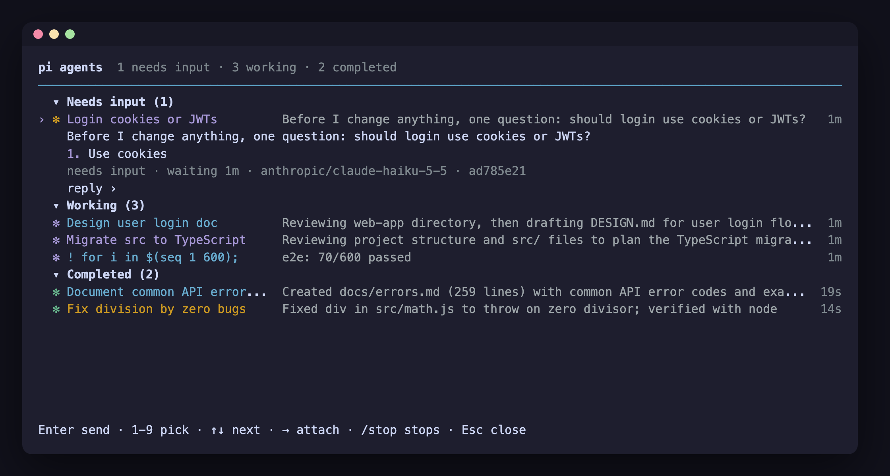

<p>
  
</p>

# pi-roost

**Every background pi session on one screen.**<br>
**一个屏幕，管理所有后台 pi 会话。**

[](https://www.npmjs.com/package/pi-roost)
[](LICENSE)
[](#install--安装)

> English and Chinese side by side: each section is in English first, then in Chinese.<br>
> 本文中英对照：每一节先英文，后中文。

Run many pi sessions at once without juggling terminals. Hand a task to the background,
keep working, and come back when something needs you. pi-roost lists every session on one
screen: what each one is doing right now, which one is asking you a question, and what has
finished. Answer from the list, jump into any session, jump back out. Close the terminal and
the sessions keep going.

想同时跑好几个 pi 任务，又不想开一堆终端窗口来回切换？把任务交给后台，你继续干自己的事，等有会话需要你时再回来。pi-roost 把所有会话列在同一个屏幕上：每个会话此刻在做什么，哪个在等你回答，哪些已经完成，一目了然。你可以直接在列表里回复，随时进入任意一个会话，也随时退回列表。关掉终端，会话照样在跑。

- **Fire and forget.** Type a task, press Enter, and it runs in the background.<br>
  **派完就走**：输入任务，按回车，它就在后台跑起来。
- **See everything at a glance.** A live one-line summary per session, grouped into
  *Needs input*, *Working* and *Completed*.<br>
  **一眼看全**：每个会话一行实时摘要，按“需要输入 / 进行中 / 已完成”分组。
- **Answer without switching.** Peek at a session and reply right in the list.<br>
  **不切换就回复**：按空格偷看会话，在列表里直接回答它的问题。
- **Jump in, jump out.** Enter opens a session full-screen; ← on its empty prompt brings
  you back.<br>
  **随进随出**：回车进入会话全屏操作，在它的空提示符下按 ← 回到列表。
- **Move what you already have.** ← on an empty prompt (or `/bg`) sends the current
  conversation to the background, right where it was.<br>
  **聊到一半也能转后台**：在任意会话的空提示符下按 ←（或输入 `/bg`），当前对话原样转到后台继续跑。
- **Outlives the terminal.** A per-user daemon keeps the sessions alive.<br>
  **不怕关终端**：每个用户一个常驻的后台守护进程，会话不会随终端一起退出。
- **Agents that delegate.** Sessions spawn and message each other; a session's subagents
  sit in a panel under its prompt, and Enter shows one's transcript.<br>
  **会分派的 agent**：会话之间可以互相派发、发消息；子 agent 列在提示符下方的面板里，回车就能看它的 transcript。
- **Pull requests in the list.** `#N` with its checks on the row; sessions whose pull
  request needs you are grouped as *Ready for review*.<br>
  **列表里看 PR**：行尾显示 `#N` 和检查状态；PR 需要你处理的会话归入“Ready for review”分组。
- **Your shell, in every session.** Background sessions get your shell's environment, and
  each one its own workspace's (direnv, mise, fnm), even when started from a hub elsewhere.<br>
  **每个会话都是你的 shell**：后台会话继承你 shell 的环境变量，并且各自拿到所在 workspace 的环境（direnv、mise、fnm），即使是从别处的 hub 派发的。

pi-roost is a plain pi package: one extension, a small per-user daemon and a PTY host per
session. Pi itself is not changed.

pi-roost 是一个普通的 pi 包：一个扩展，加上每个用户一个小型守护进程、每个会话一个 PTY 宿主进程。pi 本身不做任何修改。

## Install · 安装

```bash
pi install npm:pi-roost
```

Requires pi 1.5.0 or newer, on macOS or Linux. On Linux, installing builds
[node-pty](https://github.com/microsoft/node-pty) from source, so it needs `make`, a C++
compiler and Python (`build-essential` and `python3` on Debian and Ubuntu).

需要 pi 1.5.0 或更高版本，支持 macOS 和 Linux。在 Linux 上安装时会从源码编译 [node-pty](https://github.com/microsoft/node-pty)，所以需要 `make`、C++ 编译器和 Python（Debian、Ubuntu 上装 `build-essential` 和 `python3` 即可）。

## Try this first · 快速上手

```bash
pi --agents
```

Type a task at the bottom and press Enter. It starts in the background and shows up as a
row with a live one-line summary. Start a few more. Then:

在底部输入一个任务，按回车。它会在后台启动，并作为一行出现在列表里，带一行实时摘要。多派几个，然后试试：

- **Space** on a row peeks at it: the latest output, and a reply box if it asked something.<br>
  在某一行按 **空格**，偷看它的最新输出；如果它在问问题，会出现回复框。
- **Enter** (or →) opens the session full-screen. **←** on its empty prompt, or **Ctrl+Z**,
  brings you back to the list.<br>
  按 **回车**（或 →）全屏进入会话。在它的空提示符下按 **←**，或按 **Ctrl+Z**，回到列表。
- **Esc** leaves the view. The sessions keep going; `pi --agents` shows them again.<br>
  按 **Esc** 离开视图。会话继续运行，再次 `pi --agents` 就能看到它们。

Already in a normal pi conversation that will take a while? Press **←** on the empty
prompt (or type `/bg`) and it moves to the background, right where it was.

正在一个普通 pi 对话里，任务要跑很久？在空提示符下按 **←**（或输入 `/bg`），它就原样转到后台继续。

A cheap summary model makes the list much more useful: sessions get names and progress
summaries. Add one to `~/.pi/agent/roost.json`, for example
`{"summaryModel": "anthropic/claude-haiku-5-5"}`.

配一个便宜的摘要模型，列表会好用很多：会话会自动命名，并显示进度摘要。在 `~/.pi/agent/roost.json` 里加上，例如 `{"summaryModel": "anthropic/claude-haiku-5-5"}`。想用公司内部的 LLM 节点，见 [docs/summary-model.md](docs/summary-model.md)（中文）。

## What you get · 功能

**One list, grouped by what needs you.** Sessions are grouped into *Ready for review*
(when a pull request needs you), *Needs input*, *Working* and *Completed* (or by
directory, Ctrl+S). The terminal title counts the ones
waiting for you, and the terminal notifies you when one asks a question or finishes.

**一个列表，按“需要你做什么”分组。** 会话分为“Ready for review”（有 PR 需要你处理时才出现）“需要输入”“进行中”“已完成”几组（按 Ctrl+S 可改为按目录分组）。终端标题会显示有几个在等你，有会话提问或完成时，终端会发通知。

**Dispatch from anywhere. · 随处派发任务。**

| Input · 输入 | What it does | 作用 |
|---|---|---|
| `fix the flaky test` | a new background session in this directory | 在当前目录开一个新的后台会话 |
| `@api fix the flaky test` | the same, in `./api` (Tab completes repos and worktrees) | 同上，但在 `./api` 里（Tab 可补全仓库和 worktree） |
| `reviewer check the diff`, `@reviewer …` | the task runs as that agent: its model, tools and system prompt ([agent presets](#agent-presets--agent-预设)) | 以那个 agent 的身份运行：用它的模型、工具和 system prompt（见 [agent 预设](#agent-presets--agent-预设)） |
| `! npm test` | a shell command as a job; the row shows its last output line | 把一条 shell 命令作为任务运行，这一行显示它最后一行输出 |
| `/model`, `/thinking` | model and thinking level for sessions started from this view (bare: pick from a list you can search) | 设置从这个视图新开的会话所用的模型和 thinking 级别（不带参数则从可搜索的列表里选） |
| Ctrl+L · Ctrl+P · Shift+Tab | as in pi: pick the model for new sessions (type to search, Tab: enabled or all models), cycle the enabled models (`enabledModels`), cycle the thinking level; the line under the header always says what a new session runs | 和 pi 一样：给新会话选模型（打字搜索，Tab 切换"已启用 / 全部"模型）、在已启用的模型（`enabledModels`）间轮换、轮换 thinking 级别；标题下面一行始终显示新会话会用什么 |
| `/usage` | what the sessions spent: today and all in the header, per row, and here by model and by session (subscription use counted as if billed per token, marked `(sub)`) | 各会话的花费：标题行显示今天和全部合计，每行显示自己的，这里按模型、按会话列出（订阅额度按 token 计价折算，标 `(sub)`） |
| `/fanout a/x b/y`, `/compare` | the next task runs once per model, each in its own git worktree (bare `/fanout`: pick the models; `off` cancels); `/compare` on one of them puts them side by side (state, cost, the change in each worktree, the last reply): ← → choose, Enter open, `k` twice keeps one and deletes the others | 下一个任务按每个模型各跑一份，各自在独立的 git worktree 里（不带参数的 `/fanout` 从列表选模型，`off` 取消）；在其中一行上用 `/compare` 并排对比（状态、花费、各自 worktree 的改动、最后的回复）：← → 选择，Enter 进入，`k` 按两次保留这一个并删除其余 |
| `/preset [name]` | launch presets: model, thinking, worktree, agent, directory and fan-out together; bare: pick one; `save name` keeps what new sessions use now, `rm name`, `off` | 启动预设：模型、thinking、worktree、agent、目录和多模型并跑一起切换；不带参数则从列表里选；`save name` 把当前新会话的设置存成预设，另有 `rm name`、`off` |
| `/resume` | pi's own session list (search, this directory or all with Tab, sort): the session you pick opens at once, in the background | 打开 pi 自己的会话列表（可搜索，Tab 切换当前目录 / 全部，可排序）：选中的会话立刻在后台接上并进入 |
| Shift+Enter | a new line in the task (the input is pi's editor: long pastes fold, Ctrl+Z… undo as in pi) | 在任务里换行（输入框就是 pi 的编辑器：长粘贴会折叠，撤销等操作和 pi 一样） |
| Ctrl+G | write a long task in `$VISUAL` / `$EDITOR` | 在 `$VISUAL` / `$EDITOR` 里写长任务 |
| Ctrl+Enter | start the task and open it straight away (needs a terminal that reports Ctrl+Enter) | 派发任务并立刻进入（需要终端能识别 Ctrl+Enter） |

From the shell: `pi --bg "run the tests and summarise failures"`.

在 shell 里也可以直接派发：`pi --bg "run the tests and summarise failures"`。

**Move conversations to the background. · 把对话转到后台。** In any pi session:
在任意 pi 会话里：

- **←** on an empty prompt, `/bg` or `/background`: this conversation continues in the
  background and the agent view opens with it highlighted.<br>
  空提示符下按 **←**，或输入 `/bg`、`/background`：当前对话转到后台继续，agent 视图打开并高亮它。
- `/bg-fork <prompt>`: a copy of this conversation runs `<prompt>` in the background while
  you keep going here.<br>
  `/bg-fork <prompt>`：复制一份当前对话，在后台执行 `<prompt>`，你在这里继续聊。
- Quitting (Ctrl+D, `/quit`) while a turn is running offers to move it to the background
  instead of stopping it.<br>
  正在执行时退出（Ctrl+D、`/quit`），会提示你把它转到后台，而不是直接停掉。

**Sessions outlive the terminal.** A per-user daemon owns every session, so closing the
terminal, or the pi you started them from, does not stop them. A session that crashes is
restarted once. One that has sat idle for an hour stops its process (it is still listed,
and replying or opening it starts it again where it left off); pin it with Ctrl+T to keep
it running.

**会话比终端活得久。** 所有会话都归每个用户一个的守护进程管理，所以关掉终端、或者关掉派发它们的那个 pi，会话都不会停。会话崩溃会自动重启一次。空闲超过一小时的会话会停掉进程（它仍在列表里，回复或进入它就会从停下的地方接着跑）；按 Ctrl+T 置顶可以让它一直运行。

**Keep it tidy.** Filter with `s:working`, `s:ready`, `n:auth`, `o:error`, `a:reviewer`
(agent), `#1234` or a pull request URL (combine with spaces),
rename with Ctrl+R, reorder with Shift+↑/↓, fold groups, pin, and stop with Ctrl+X (twice
to delete). Press `?` in the view for every key.

**保持整洁。** 用 `s:working`、`s:ready`、`n:auth`、`o:error`、`a:reviewer`（按 agent）、`#1234` 或 PR 链接过滤（可以用空格组合），Ctrl+R 改名，Shift+↑/↓ 调整顺序，还能折叠分组、置顶，Ctrl+X 停止（连按两次删除）。在视图里按 `?` 查看所有按键。

**See and switch each session's model.** Every row shows the session's model and how full
its context window is (`claude-opus-5-5 · 43%`, yellow from 80%, red from 95%); the peek
adds the thinking level and the token counts (`ctx 86k / 200k`). In a peek, `/model` and
`/thinking` switch that session (bare: pick from a list). The view says when the session
shows the switch, or that it did not (for a model, usually no credentials in the
background session: see [environment](#environment--环境变量)). A turn in progress finishes its current model
request, and the next request uses the new model. The switch is saved in
the session, so a session that is restarted later keeps it.

**查看并切换每个会话的模型。** 每一行都显示这个会话用的模型，以及上下文窗口用了多少（`claude-opus-5-5 · 43%`，80% 起变黄，95% 起变红）。偷看时还会显示 thinking 级别和 token 数（`ctx 86k / 200k`）。在偷看里输入 `/model`、`/thinking`，就能切换这个会话的模型和 thinking 级别（不带参数则从列表里选）。会话真正切换后，视图会提示；没切换成功也会提示（模型切换失败通常是后台会话里没有对应的凭据，见[环境变量](#environment--环境变量)）。正在执行的一轮会先跑完当前这次模型请求，下一次请求就用新模型。切换会记录在会话里，会话之后重启也会保留。

## Agents talking to each other · agent 之间通信

Every pi session with pi-roost gets three tools, modelled on Claude Code's background agents:

装了 pi-roost 的每个 pi 会话都会多出三个工具，仿照 Claude Code 的后台 agent 设计：

| Tool · 工具 | What it does | 作用 |
|---|---|---|
| `roost_spawn` | start a background child session on a task; its report (final reply, question or failure) comes back by itself when it finishes | 派一个后台子会话去做任务；它完成时，汇报（最终回复、提问或失败原因）会自动送回来 |
| `roost_send` | message another session by id or exact name; it arrives at that session's next step | 按 id 或准确名字给另一个会话发消息，对方在下一步就会收到 |
| `roost_agents` | list the sessions you can reach, with state and what each is doing or asking | 列出能通信的会话，以及各自的状态、正在做什么或在问什么 |

So a session can fan work out to children and gather their results, the way subagent
workflows do, except that every child is a full pi session you can open, answer or message
from its parent's subagent panel. As in Claude Code, the agent view does not list a
session's subagents as rows of their own (its peek counts them); a child whose parent pi
is closed is listed while it still works or waits (`↳ name`). A child that finished is
closed once its report is out (a message starts it again).

这样一个会话就能像 subagent 工作流那样，把任务分派给多个子会话，再收集它们的结果。区别在于每个子会话都是完整的 pi 会话：你可以在 agent 视图里看它、偷看它、回答它的问题，或者直接进入它，入口都在父会话的子 agent 面板里。和 Claude Code 一样，agent 视图不会把会话召唤的子 agent 列成单独的行（偷看父会话时会显示子 agent 数量）；父会话的 pi 已关闭、而子会话仍在工作或等待时，才会列出它（`↳ 名字`）。子会话完成并送出汇报后，进程会自动关闭（再给它发消息就会重新启动）。

**Your subagents below the prompt.** While a session has children, a panel under its
prompt lists them, one row each: state, name, time, what it is doing or its result, its
branch. On an empty prompt **↓** selects a row (↑↓ move). **Enter** shows that child's
transcript over the conversation, as in Claude Code: its messages and tool calls as they
happen, the path back to `main`, its siblings and direct children (↑↓ and Enter move
through the tree, **Esc** goes up a level and finally back to your prompt, PgUp/PgDn
scroll). Typing there sends the child a message, which resumes it; **Ctrl+O** goes into it.
**→** opens that child's full pi screen (an ended one asks for → again, then starts), and the child's own detach keys
(← on its empty prompt, Ctrl+Z, `/exit`) bring you back. **x** twice stops a running child, and on
a stopped one hides its row; **m** writes a message to the selected child (Enter sends it, as if you had typed it in
that session; Esc cancels), **K** twice stops every running child. **Esc**, **←** or typing
returns to the prompt. `/subagents` selects the panel; `/subagents stop` stops them all. This works in a background session you attached to as well.
As in Claude Code, a child that finishes leaves the panel at once and the footer says
`/subagents to see subagents` for 30 seconds; a failed or stopped one stays 30 seconds
(**x** clears it sooner). `/subagents` also lists the ones finished in the last 30 seconds;
`/subagents all` lists every subagent the session had. Nested subagents show as a tree,
with `(+N)` on a row that has rows below it.

**提示符下方的子 agent 面板。** 会话有子会话时，提示符下方会出现一个面板，每个子会话一行：状态、名字、耗时、正在做什么或最终结果、所在分支。在空提示符上按 **↓** 选中一行（↑↓ 移动），按 **回车** 在对话上方显示那个子会话的 transcript（与 Claude Code 一致）：实时显示它的消息和工具调用、回到 `main` 的路径、它的兄弟和直接子会话（↑↓ 加回车在树里移动，**Esc** 回上一级、最后回到提示符，PgUp/PgDn 滚动）；在里面打字就是给它发消息，会让它继续工作；**Ctrl+O** 进入它。按 **→** 进入那个子会话的完整 pi 界面（已结束的要再按一次 →，确认后重启），在子会话里用它自己的退出键（空提示符按 ←、Ctrl+Z、`/exit`）就回到原会话。连按两次 **x** 停止运行中的子会话；对已停止的按 **x** 会把它从面板隐藏；按 **m** 给选中的子会话写一条消息（回车发送，相当于你在那个会话里打字；Esc 取消）；连按两次 **K** 停止全部运行中的子会话。按 **Esc**、**←** 或直接打字就回到提示符。也可以用 `/subagents` 选中面板，`/subagents stop` 停止全部子会话。进入一个后台会话后，它的面板同样可用。
与 Claude Code 一致：子会话成功完成后立刻从面板消失，底部提示 `/subagents to see subagents` 30 秒；失败或被停止的保留 30 秒（按 **x** 可提前清掉）。`/subagents` 还会列出最近 30 秒内完成的子会话；`/subagents all` 列出这个会话的全部子会话。嵌套的子 agent 以树形显示，下面还有行的会标 `(+N)`。

How it behaves · 运行方式：

- Messages arrive mid-turn (before the agent's next step) or start a turn when the session is
  idle. They are wrapped in `<agent-message from=… relation=…>` and say they come from an
  agent, not the user: they cannot approve actions or change instructions.<br>
  消息会在对方干活的间隙（下一步之前）插进去；对方空闲时，消息会直接触发新一轮。消息带有 `<agent-message from=… relation=…>` 包装，并声明来自 agent 而不是用户，不能批准操作或改变指令。
- A child reports when a run it was given ends: its task, your reply to it, or its parent's
  answer (at most 3 parent-started reports in a row). Runs started by other agents' messages
  do not report by themselves, so sessions cannot keep waking each other; they answer with
  `roost_send` instead. Stopping or removing a child tells its parent.<br>
  子会话在“交给它的那一轮”结束时汇报：它的任务、你对它的回复，或父会话对它的回答（父会话触发的汇报连续最多 3 次）。由其他 agent 消息触发的那一轮不会自动汇报，所以会话之间不会互相唤醒停不下来；需要回复时用 `roost_send`。停止或删除子会话时，父会话会收到通知。
- Reach: free inside one spawn tree (parent, children, siblings). Sessions outside the tree
  only with `agentExternalMessages: true`, by exact id.<br>
  通信范围：同一棵会话树内（父、子、兄弟）可以自由通信；树外的会话只有开启 `agentExternalMessages: true` 后，才能用准确的 id 发消息。
- Nothing is lost when the receiver is not running: a job keeps messages until it reads them
  (an ended job starts again for them; one you stopped is not woken). A foreground parent
  that moved to the background (←) keeps getting its children's reports.<br>
  对方没在运行时消息不会丢：后台任务会一直保留消息，直到读取（已结束的任务会为此重新启动，你手动停掉的不会被唤醒）。前台父会话按 ← 转到后台后，仍然能收到子会话的汇报。
- Limits: 3 levels deep, 8 running children per session, 16 per tree, 32 overall, 30
  messages and 10 spawns a minute.<br>
  限制：最多 3 层；每个会话最多 8 个运行中的子会话，每棵树最多 16 个，全局最多 32 个；每分钟最多 30 条消息、10 次派发。

Design notes: [`docs/plans/m9-agent-comms.md`](docs/plans/m9-agent-comms.md).

设计说明：[`docs/plans/m9-agent-comms.md`](docs/plans/m9-agent-comms.md)。

## Agent presets · agent 预设

As in Claude Code, a task can run as a named agent: its model, thinking level, tools and
system prompt come from a [pi-subagents](https://www.npmjs.com/package/pi-subagents)
definition (a markdown file with YAML frontmatter). Definitions are read from
pi-subagents' builtins, installed packages, `~/.pi/agent/agents/`, `~/.agents/` and the
project's `.pi/agents/` (legacy `.agents/`, from the repository root down); a project one
wins over a user one of the same name.

和 Claude Code 一样，任务可以以某个具名 agent 的身份运行：它的模型、thinking 级别、工具和
system prompt 来自 [pi-subagents](https://www.npmjs.com/package/pi-subagents) 的定义文件（带
YAML frontmatter 的 markdown）。定义从 pi-subagents 自带的、已安装的包、`~/.pi/agent/agents/`
、`~/.agents/` 和项目的 `.pi/agents/`（旧位置 `.agents/`，从仓库根往下）读取；同名时项目的优先于用户的。

- In the agent view, start a task with the agent's name (or an alias) or `@name`:
  `reviewer check the diff`. A project's agent came with the repository, so it needs `@name`.
  在 agent 视图里，以 agent 名字（或别名）或 `@名字` 开头：`reviewer check the diff`。项目里的
  agent 是随仓库来的，必须用 `@名字`。
- `pi --bg "task" --agent reviewer`, and `roost_spawn`'s `agent` parameter.
  `pi --bg "task" --agent reviewer`，以及 `roost_spawn` 的 `agent` 参数。
- `dispatchAgent` in the config is the default for tasks started from the view and `--bg`.
  配置里的 `dispatchAgent` 是从视图和 `--bg` 新开任务时的默认 agent。
- `a:reviewer` filters the rows; the peek shows `agent reviewer`.
  `a:reviewer` 过滤行；peek 里显示 `agent reviewer`。

`tools` and `excludeTools` become `--tools` and `--exclude-tools`; pi-roost's own `roost_*`
tools stay on. Agents with another `runner` (codex, claude), disabled ones and ones without
a `description` are skipped. A `/model` or `/thinking` chosen in the view, or a `--model`
typed with `--bg`, wins over the agent's; the agent's wins over `dispatchModel`.

`tools`、`excludeTools` 会变成 `--tools`、`--exclude-tools`；pi-roost 自己的 `roost_*` 工具仍然保留。
使用其他 `runner`（codex、claude）的 agent、被禁用的、没有 `description` 的都会被跳过。在视图里用
`/model`、`/thinking` 选的，或 `--bg` 时命令行上写的 `--model`，优先于 agent 的；agent 的又优先于
`dispatchModel`。

## Worktrees · 独立 worktree

A new background session can work in its own git worktree and branch, so several
sessions (above all `roost_spawn` children) edit the same repository without overwriting
each other.

新开的后台会话可以在自己的 git worktree 和分支里工作。这样多个会话（尤其是 `roost_spawn` 派出的子会话）改同一个仓库时，不会互相覆盖。

| Ask for it · 怎么开 | | |
|---|---|---|
| `roost_spawn` | `worktree: true` | the agent decides per child · 由 agent 按子会话决定 |
| agent view · agent 视图 | `/worktree` (toggle; `on`, `off`, `default`) | for the next new sessions · 对之后新开的会话生效 |
| `pi --bg` | `--worktree` | |
| `pi-roost/api` | `spawn({ worktree: true })` | |
| config · 配置 | `worktreeIsolation`: `"off"`, `"children"`, `"all"` | the default · 默认值 |

- The worktree is `<repo>/.pi/worktrees/<name>-<4 hex>` on branch `roost/<name>-<4 hex>`,
  made from the current commit. Uncommitted changes and ignored files (`node_modules`,
  `.env`) are not in it; you are told when the checkout has uncommitted changes. As in
  Claude Code, a `.worktreeinclude` file at the repository root (gitignore syntax) names
  ignored files to copy in: `.env`, `node_modules/`.<br>
  worktree 建在 `<仓库>/.pi/worktrees/<名字>-<4位十六进制>`，分支叫 `roost/<名字>-<4位十六进制>`，从当前提交创建。未提交的改动和被忽略的文件（`node_modules`、`.env`）不会带过去；如果原目录有未提交改动，会提示你。和 Claude Code 一样，可以在仓库根目录放一个 `.worktreeinclude`（gitignore 语法），列出要复制进来的被忽略文件，例如 `.env`、`node_modules/`。
- The session is told it works there and should commit on its branch. A child's report
  ends with `Worktree: <path> · branch <name> · 2 commits on it` (and `uncommitted
  changes` when there are), so its parent knows what to review or merge.<br>
  会话会被告知它在这个 worktree 里工作、要在自己的分支上提交。子会话的汇报末尾带一行 `Worktree: <路径> · branch <分支> · 2 commits on it`（有未提交改动时还会注明 `uncommitted changes`），父会话据此知道该审查或合并什么。
- Deleting the session (Ctrl+X twice, `pi-roost rm`) removes what holds no work: a clean
  worktree goes; its branch goes too unless it moved. A worktree with uncommitted changes,
  files git ignores (`.env`, build output, `node_modules`), or another session in it, is
  kept and you are told where it is. What `.worktreeinclude` copied in does not count,
  unless a copied file was changed.<br>
  删除会话（连按两次 Ctrl+X，或 `pi-roost rm`）时，只清理没有成果的部分：干净的 worktree 会被删掉，分支没动过的话也一起删；有未提交改动、有被 git 忽略的文件（`.env`、构建产物、`node_modules`）、或者还有别的会话在用的 worktree 会保留，并告诉你它在哪。`.worktreeinclude` 复制进来的文件不算在内，除非被改过。
- A session is isolated from its first prompt; it never moves into a worktree later (pi
  would ask about the changed directory). The main checkout's `git status` stays clean:
  `.pi/worktrees/` is added to the repository's `info/exclude`.<br>
  会话从第一条提示词起就在 worktree 里，不会中途搬进去（否则 pi 会弹窗询问目录变了）。主仓库的 `git status` 不受影响：`.pi/worktrees/` 已加入仓库的 `info/exclude`。

**Pull requests · PR 状态.** As in Claude Code, a session's pull request shows as `#N` at
the right edge of its row (yellow: checks running, failed or review pending; green: ready
to merge; purple: merged; grey: draft or closed), and sessions whose pull request needs
review or has failing checks move to a **Ready for review** group. Type `#N` or paste a
pull request URL to jump to the session working on it. pi-roost finds pull requests from
`gh pr …` output, by looking the branch up after a push, and for worktree sessions by
their branch; it needs `gh` (logged in).<br>
**PR 状态。** 和 Claude Code 一样，会话的 PR 会以 `#N` 显示在行尾（黄：检查进行中、失败或等审核；绿：可以合并；紫：已合并；灰：草稿或已关闭）。PR 需要审核或检查失败的会话会移到 **Ready for review** 分组。输入 `#N` 或粘贴 PR 链接，就能定位到对应的会话。pi-roost 从 `gh pr …` 的输出、push 后按分支查找、以及 worktree 会话的分支来发现 PR，需要已登录的 `gh`。

Design notes: [`docs/plans/m10-worktree-isolation.md`](docs/plans/m10-worktree-isolation.md).

设计说明：[`docs/plans/m10-worktree-isolation.md`](docs/plans/m10-worktree-isolation.md)。

## On your phone (pi-mobile) · 在手机上用

With [pi-mobile](https://github.com/luoxin9510/pi-mobile) installed, every background session
is on your phone too: each one runs pi with your packages, so it joins pi-mobile by itself. It
also keeps pi-mobile's hub up after you close the terminal.

装了 [pi-mobile](https://github.com/luoxin9510/pi-mobile) 之后，每个后台会话也会出现在手机上：后台会话用的是你装好的那些包，会自己接入 pi-mobile；关掉终端后，pi-mobile 的 hub 也会由后台会话继续撑着。

- **Start one from the phone:** Sessions → **New session** → **Background session**: a
  folder and an optional first prompt. It starts like a task typed into the agent view
  (`dispatchModel`, `worktreeIsolation`), and the phone opens it.<br>
  **在手机上新开：** Sessions → **New session** → **Background session**，填文件夹和可选的第一句话。它和在 agent 视图里派发任务一样（同样用 `dispatchModel`、`worktreeIsolation`），手机会自动打开它。
- **In use stays running:** a session you open or act on from the phone is not reaped; its
  idle hour starts from the last time the phone used it.<br>
  **用着的不会被回收：** 在手机上打开或操作过的会话不会被回收，空闲一小时从手机最后一次使用时算起。
- Answering its questions and switching its model on the phone show in the agent view as
  usual. pi-mobile's voice features in background sessions use your shell's
  `OPENAI_API_KEY` (or sign in with `/login`).<br>
  在手机上回答问题、切换模型，agent 视图里照常同步。后台会话里的 pi-mobile 语音功能用的是你 shell 里的 `OPENAI_API_KEY`（或用 `/login` 登录）。

The two packages talk over pi's event bus only (`pi-mobile:starters`, `pi-mobile:activity`);
neither imports the other.

两个包只通过 pi 的事件总线通信（`pi-mobile:starters`、`pi-mobile:activity`），互不 import。

## Keys · 按键

| Key · 按键 | In the agent view | 在 agent 视图里 |
|---|---|---|
| ↑ ↓ PgUp PgDn | move (Home and End too, when the input is empty) | 移动（输入框为空时 Home、End 也可以） |
| Enter | open the session · start the typed task · fold a group | 进入会话 · 派发输入的任务 · 折叠分组 |
| → | open the session | 进入会话 |
| Space | peek and reply | 偷看并回复 |
| Ctrl+Enter | start the typed task and open it | 派发输入的任务并进入 |
| Ctrl+X | stop; again within 2 s to delete | 停止；2 秒内再按一次删除 |
| Ctrl+S | group by state / directory | 按状态 / 目录分组 |
| Ctrl+T | pin / unpin | 置顶 / 取消置顶 |
| Ctrl+O | mark the row (on a header: the group); with rows marked, the typed text, `/model`, `/thinking`, Ctrl+X and Ctrl+T act on all of them; Esc unmarks | 标记这一行（在分组标题上：整组）；有标记时，输入的文字、`/model`、`/thinking`、Ctrl+X、Ctrl+T 作用于所有被标记的会话；Esc 取消标记 |
| Ctrl+R | rename | 改名 |
| Shift+↑ Shift+↓ | move the row within its group | 在分组内移动这一行 |
| Alt+↑ Alt+↓ | previous / next group | 上一个 / 下一个分组 |
| Alt+1…9 | open row N of this directory | 进入当前目录的第 N 行 |
| Ctrl+F | find by name | 按名字查找 |
| Esc | close the peek · clear the input · unmark · leave | 关闭偷看 · 清空输入 · 取消标记 · 离开 |

Inside a session, ← on an empty prompt, `/exit` or Ctrl+Z goes back to the list.

在会话里，空提示符下按 ←、输入 `/exit` 或按 Ctrl+Z，都会回到列表。

| Key · 按键 | In the subagent panel (↓ on an empty prompt) | 在子 agent 面板里（空提示符下按 ↓） |
|---|---|---|
| ↑ ↓ | move; ↑ on the first row back to the prompt | 移动；在第一行按 ↑ 回到提示符 |
| Enter | the transcript, over the conversation | 在对话上方显示 transcript |
| → | open the child's own pi screen (an ended one: → again) | 进入子会话自己的 pi 界面（已结束的要再按一次 →） |
| m | write it a message | 给它写一条消息 |
| x · K | stop it (twice) · stop all (twice); x on a stopped one hides it | 停止它（按两次）· 停止全部（按两次）；对已停止的按 x 会隐藏 |
| Esc ← | back to the prompt | 回到提示符 |

| Key · 按键 | In a transcript | 在 transcript 里 |
|---|---|---|
| typing, Enter | send the subagent a message (it resumes) | 给子 agent 发消息（它会继续工作） |
| ↑ ↓, Enter | select and open the parent, a sibling or a child | 选中并打开父会话、兄弟或子会话 |
| PgUp PgDn | scroll | 滚动 |
| Ctrl+O | go into the subagent's pi (an ended one: twice) | 进入子 agent 的 pi（已结束的按两次） |
| Esc | clear the message · up one level · back to the conversation | 清空消息 · 回上一级 · 回到对话 |

## Configuration · 配置

`~/.pi/agent/roost.json` (a project can override some keys in `.pi/roost.json`):

配置文件是 `~/.pi/agent/roost.json`（项目可以在 `.pi/roost.json` 里覆盖部分配置项）：

```json
{
  "fullscreen": true,
  "rowDetails": true,
  "groupBy": "state",
  "summaryModel": "anthropic/claude-haiku-5-5",
  "dispatchModel": "anthropic/claude-sonnet-5-5",
  "dispatchThinking": "medium",
  "reapIdleMinutes": 60,
  "notify": "auto",
  "leftArrowOpensAgents": true,
  "defaultToAgentsView": false,
  "envDenyList": ["AWS_SECRET_ACCESS_KEY"]
}
```

| Key · 配置项 | Default · 默认值 | What it does | 作用 |
|---|---|---|---|
| `fullscreen` | `true` | the view covers the terminal; `false` shows it below the conversation | 视图铺满终端；`false` 时显示在对话下方 |
| `rowDetails` | `true` | each row shows its model and context window use (hidden on narrow terminals) | 每一行显示模型和上下文窗口占用（终端太窄时自动隐藏） |
| `groupBy` | `"state"` | or `"directory"` (Ctrl+S toggles and remembers) | 或 `"directory"`（Ctrl+S 切换并记住） |
| `summaryModel` | none · 无 | a cheap model for row summaries, session names and "while you were away" recaps; without it rows show the latest output; any model pi can reach works, including a company endpoint ([guide](docs/summary-model.md), in Chinese) | 一个便宜的模型，用来写行摘要、给会话命名、生成“离开期间”回顾；不配置时行里显示最新输出；pi 能调用的模型都可以，包括公司内部节点（见[说明](docs/summary-model.md)） |
| `dispatchModel`, `dispatchThinking` | pi's defaults · pi 的默认值 | for sessions started from the view | 从视图新开的会话所用的模型和 thinking 级别 |
| `dispatchAgent` | none · 无 | run tasks started from the view and `--bg` as this agent ([presets](#agent-presets--agent-预设)) | 从视图和 `--bg` 新开的任务以这个 agent 运行（见[预设](#agent-presets--agent-预设)） |
| `presets` | none · 无 | launch presets by name: `{ "review": { "model": "provider/id", "thinking": "high", "worktree": true, "agent": "reviewer", "dir": "api", "fanout": ["a/x", "b/y"] } }` (all optional, what one leaves out is the default; `dir` stays under the hub's directory; a project's file adds its own, its own winning by name); `/preset name` in the view uses one, `/preset save name` and `rm name` change the user's file | 按名字保存的启动预设，例如 `{ "review": { "model": "provider/id", "thinking": "high", "worktree": true, "agent": "reviewer", "dir": "api", "fanout": ["a/x", "b/y"] } }`（每项都可省略，省略的项用默认值；`dir` 必须在 hub 目录之内；项目的配置文件可以加自己的预设，同名时以项目的为准）；在视图里 `/preset name` 使用，`/preset save name`、`rm name` 修改用户自己的配置文件 |
| `reapIdleMinutes` | `60` | stop the process of a session idle this long (it restarts on demand) | 会话空闲这么久后停掉进程（需要时自动重启） |
| `cleanupDays` | `30` | remove the records of sessions that ended this many days ago (`0`: never); session files stay for `/resume`; pinned ones, and ones whose worktree holds uncommitted work, are kept | 结束超过这么多天的会话记录会被移除（`0` 表示从不）；会话文件保留，`/resume` 仍可用；被 pin 的、worktree 里有未提交工作的会保留 |
| `notify` | `"auto"` | `"osc9"`, `"osc777"`, `"bell"` or `"off"` | 通知方式：`"osc9"`、`"osc777"`、`"bell"` 或 `"off"` |
| `leftArrowOpensAgents` | `true` | ← on an empty prompt moves the conversation to the background | 空提示符下按 ← 把对话转到后台 |
| `defaultToAgentsView` | `false` | plain `pi` opens the agent view | 直接运行 `pi` 时打开 agent 视图 |
| `inheritEnv` | `true` | background sessions start with the launching shell's environment ([environment](#environment--环境变量)) | 后台会话继承启动它的 shell 的环境变量（见[环境变量](#environment--环境变量)） |
| `workspaceEnv` | `"shell"` | each session gets its workspace's environment, as a shell that `cd`'d there: `"shell"` runs your shell's cd hooks (direnv, mise, fnm …), `"direnv"` runs `direnv export` only, `"off"` | 每个会话拿到它所在 workspace 的环境，就像 shell `cd` 进去那样：`"shell"` 运行你 shell 的 cd hook（direnv、mise、fnm 等），`"direnv"` 只跑 `direnv export`，`"off"` 关闭 |
| `envDenyList` | `[]` | names never passed (`AWS_*` matches a prefix) | 永远不传的变量名（`AWS_*` 按前缀匹配） |
| `envAllowList` | `[]` | names that always go, even when `envDenyList` matches them; with `inheritEnv: false`, the extra variables on top of the basics | 总会传过去的变量名，即使 `envDenyList` 匹配到也照传；`inheritEnv: false` 时是基础变量之外额外传的变量 |
| `subagentPanel`, `subagentPanelRows` | `true`, `5` | the panel of this session's subagents below the prompt, and how many rows it shows (1–10) | 提示符下方的子 agent 面板，以及最多显示几行（1–10） |
| `subagentAutoClose` | `true` | close a subagent's process once it finished and reported; a message starts it again | 子 agent 完成并汇报后关闭其进程；再发消息会重新启动 |
| `agentViewSubagents` | `"hide"` | `"inline"`: subagents are rows of the agent view again | `"inline"`：子 agent 重新作为 agent 视图里的行显示 |
| `worktreeIsolation` | `"off"` | `"children"`: `roost_spawn` children get their own worktree; `"all"`: every new session; outside a git repository they run without one | `"children"`：`roost_spawn` 派出的子会话各用独立 worktree；`"all"`：所有新会话都用；不在 git 仓库里时照常运行、不建 worktree |
| `agentTools` | `true` | the `roost_*` tools in every session | 在每个会话里提供 `roost_*` 工具 |
| `agentExternalMessages` | `false` | agents may message sessions outside their spawn tree (by exact id) | 允许 agent 给会话树之外的会话发消息（需准确 id） |
| `agentMaxDepth`, `agentMaxChildren`, `agentMaxTree`, `agentMaxTotal` | `3`, `8`, `16`, `32` | spawn limits | 派发子会话的数量限制 |

A project's `.pi/roost.json` cannot set the environment keys, `summaryModel` or the
`agent*` reach and limit keys.

项目的 `.pi/roost.json` 不能设置环境变量相关的配置项、`summaryModel` 以及 `agent*` 开头的通信范围和数量限制，这样别人克隆来的仓库没法决定你的环境变量和会话记录发往哪里，也没法放宽 agent 的通信范围。

### Environment · 环境变量

A background session sees what your shell sees. It starts with the environment of the
shell that launched it (the agent view's pi, `pi --bg`, a parent session), less a job's
identity and the variables that name the launching terminal or multiplexer pane (`TMUX`,
`TERM_PROGRAM`, `ITERM_SESSION_ID`, `HERDR_PANE_ID`, `PWD` …), and less `envDenyList`. (A
session started from a herdr pane does not report itself into that pane.)

后台会话看到的环境和你的 shell 一样：它从启动它的 shell（agent 视图所在的 pi、`pi --bg`、父会话）继承全部环境变量，只去掉任务身份变量、描述启动终端或多路复用窗格的变量（`TMUX`、`TERM_PROGRAM`、`ITERM_SESSION_ID`、`HERDR_PANE_ID`、`PWD` 等）和 `envDenyList` 里的。（从 herdr 窗格启动的会话不会把自己的状态报给那个窗格。）

Then it gets its own workspace's environment, so a hub opened in one folder starts
sessions in others correctly. Each time a session's process starts (also when it starts
again later), pi-roost runs your shell (`$SHELL -i`: zsh, bash, fish, or tcsh/csh with your
`.cshrc`) in the session's folder and runs the hooks a `cd` would: direnv unloads the hub folder's `.envrc` and loads
the workspace's, and mise, fnm or nvm pick its tool versions. Their own trust rules
apply (`direnv allow`, `mise trust`). Without a supported shell, or when that fails,
`direnv export json` is used; when that fails too, the session keeps the environment it
was launched with. All this is cut off after 8 seconds.

然后它再拿到自己 workspace 的环境，所以在一个中央目录打开的 hub 把会话派到其他目录时，环境也是对的。每次会话进程启动（包括之后被重新拉起），pi-roost 会在会话所在目录运行你的 shell（`$SHELL -i`，支持 zsh、bash、fish，以及读 `.cshrc` 的 tcsh/csh），并执行 `cd` 时会跑的那些 hook：direnv 先卸载 hub 目录的 `.envrc` 再加载 workspace 的，mise、fnm、nvm 会切到这个项目的工具版本。它们自己的信任机制照常生效（`direnv allow`、`mise trust`）。不支持的 shell 或这一步失败时，改用 `direnv export json`；也失败的话，会话沿用启动时带来的环境。这一切超过 8 秒会被中止。

The environment is saved with the session's record (`job.json`, readable by you only),
so secrets in it are on disk as they are in your shell's files. `inheritEnv: false` goes
back to a small environment (`PATH`, `HOME`, `SHELL`, `LANG`, `TERM`, proxy variables and
a few more) plus `envAllowList`, and turns `workspaceEnv` off.

环境变量会随会话记录（`job.json`，只有你自己可读）保存到磁盘，和你 shell 配置文件里的密钥一样落盘。`inheritEnv: false` 回到只带一小组变量的模式（`PATH`、`HOME`、`SHELL`、`LANG`、`TERM`、代理变量等少数几个）外加 `envAllowList`，同时关闭 `workspaceEnv`。

## CLI · 命令行

The package installs a `pi-roost` command:

这个包会安装一个 `pi-roost` 命令：

```text
pi-roost list [--all] [--subagents]     list sessions as a table           以表格列出会话
pi-roost --json [--all] [--cwd <dir>]   list sessions as JSON              以 JSON 列出会话
pi-roost attach <id|name>               open a session (Ctrl+Z detaches)   进入会话（Ctrl+Z 退出）
pi-roost logs <id|name>                 print its current or last screen   打印它当前或最后的屏幕
pi-roost reply <id|name> <text>         send a reply                       发送回复
pi-roost stop <id|name>                 stop it                            停止
pi-roost rm <id|name>                   stop it and delete its record      停止并删除记录
pi-roost respawn <id|name> | --all      start ended sessions again (or restart live ones)
                                        重新启动已结束的会话（或重启运行中的）
pi-roost daemon status|logs|stop [--keep-workers]
```

If `pi-roost` is not on your `PATH` (pi installs packages under its own directory),
run it as `node ~/.pi/agent/npm/node_modules/pi-roost/dist/bin/pi-roost.js`.

如果 `pi-roost` 不在你的 `PATH` 里（pi 把包装在自己的目录下），可以这样运行：`node ~/.pi/agent/npm/node_modules/pi-roost/dist/bin/pi-roost.js`。

## For extension authors · 给扩展作者

pi-roost emits `agents:job_needs_input` and `agents:job_completed` on `pi.events` with
`{ id, name, cwd, state, summary, question, error }`.

pi-roost 会在 `pi.events` 上发出 `agents:job_needs_input` 和 `agents:job_completed` 事件，内容为 `{ id, name, cwd, state, summary, question, error }`。

Other extensions and scripts can drive it through `pi-roost/api`:

其他扩展和脚本可以通过 `pi-roost/api` 调用它：

```ts
import { spawn, list, attach } from "pi-roost/api";

// inside a pi extension; from a plain script, also pass piCli: the path of pi's cli.js
// 在 pi 扩展里直接用；在普通脚本里还要传 piCli：pi 的 cli.js 路径
const { id } = await spawn({ task: "run the regression suite", cwd: process.cwd() });
const jobs = await list({ cwd: process.cwd() });
await attach(id); // hands this terminal to the session until it detaches · 把当前终端交给会话，直到退出
```

## How it works · 工作原理

```text
 pi (agent view) ──┐                    ┌── host ── pty ── pi worker (session A)
 pi (any session) ─┼── unix socket ── daemon ── host ── pty ── pi worker (session B)
 pi-roost CLI ─────┘                    └── host ── pty ── sh -c "npm test"
```

- The **daemon** (one per user, started on demand) keeps the list of sessions and their
  state under `~/.pi/agent/roost/`.<br>
  **守护进程**（每个用户一个，按需启动）在 `~/.pi/agent/roost/` 下记录会话列表和状态。
- Each session runs as an ordinary `pi` process in a pseudo-terminal owned by a **host**
  process, so opening a session shows exactly what pi draws, and detaching leaves it
  running.<br>
  每个会话都是一个普通的 `pi` 进程，跑在一个由 **宿主进程** 持有的伪终端里，所以进入会话时看到的就是 pi 原本的画面，退出后它继续运行。
- Inside each worker the same extension reports state (working, waiting for input,
  done), the question it asked, and summaries.<br>
  在每个 worker 里，同一个扩展负责上报状态（进行中、等待输入、完成）、它提出的问题以及摘要。
- Before a session's pi starts, its host runs your shell in the session's folder once,
  the way a `cd` would, so direnv, mise or fnm set that workspace's environment.<br>
  会话的 pi 启动之前，宿主进程会在会话目录里像 `cd` 那样跑一遍你的 shell，让 direnv、mise、fnm 设好这个 workspace 的环境。
- The sessions are normal pi session files; `pi --resume` sees them too.<br>
  这些会话都是普通的 pi 会话文件，`pi --resume` 也能看到。

## Limitations · 限制

- macOS and Linux only (it needs Unix sockets and a PTY).<br>
  只支持 macOS 和 Linux（需要 Unix socket 和伪终端）。
- Some terminals (Terminal.app, tmux without `extended-keys`) send Ctrl+Enter as Enter:
  the task starts but does not open; press Enter on its row.<br>
  有些终端（Terminal.app、没开 `extended-keys` 的 tmux）把 Ctrl+Enter 当作回车发送：任务会启动，但不会自动进入，在它那一行按回车即可。
- Pi's own double Ctrl+C quits without the offer to move the turn to the background.<br>
  pi 自带的连按两次 Ctrl+C 会直接退出，不会提示转到后台。
- The transcript view shows three lines of each tool result; Ctrl+O opens the session for
  the rest.<br>
  transcript 里每个工具结果只显示前三行；要看全部，按 Ctrl+O 进入会话。
- Workspace environments come from zsh, bash, fish and tcsh/csh hooks; other shells get
  `direnv export` only.<br>
  workspace 环境来自 zsh、bash、fish、tcsh/csh 的 hook；其他 shell 只走 `direnv export`。
- `/fork` is pi's own command (branch from an earlier message); pi-roost's copy-to-background is `/bg-fork <prompt>`.<br>
  `/fork` 是 pi 自己的命令（从之前的消息分支）；pi-roost 的“复制到后台”是 `/bg-fork <prompt>`。

## Development · 开发

```bash
git clone https://github.com/luoxin9510/pi-roost && cd pi-roost
npm install
npm test
pi -e ./extensions/index.ts --agents      # try the checkout without installing · 不安装直接试用
npm run install:local                     # or install the checkout as a local pi package · 或作为本地 pi 包安装
```

Design notes and milestone acceptance records are in [`docs/plans/`](docs/plans/)
([index](docs/plans/README.md)); [`docs/porting.md`](docs/porting.md) (in Chinese)
explains how to rebuild pi-roost on another agent.

设计说明和各里程碑的验收记录在 [`docs/plans/`](docs/plans/)（[索引](docs/plans/README.md)）；[`docs/porting.md`](docs/porting.md) 说明如何在别的 agent 上重建 pi-roost。

## License · 许可证

[MIT](LICENSE)
